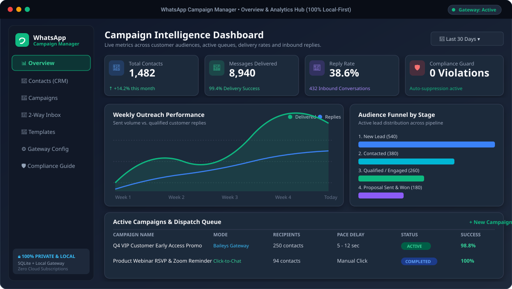
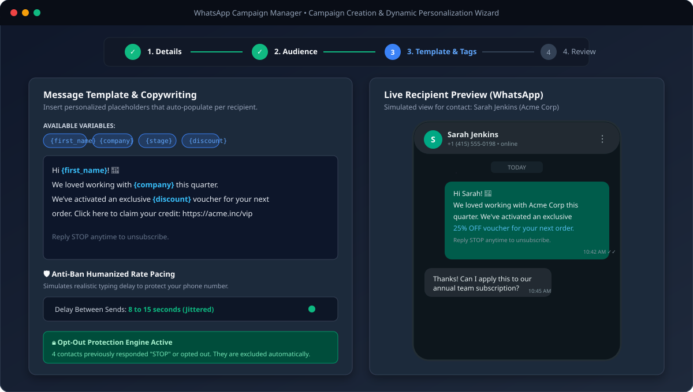
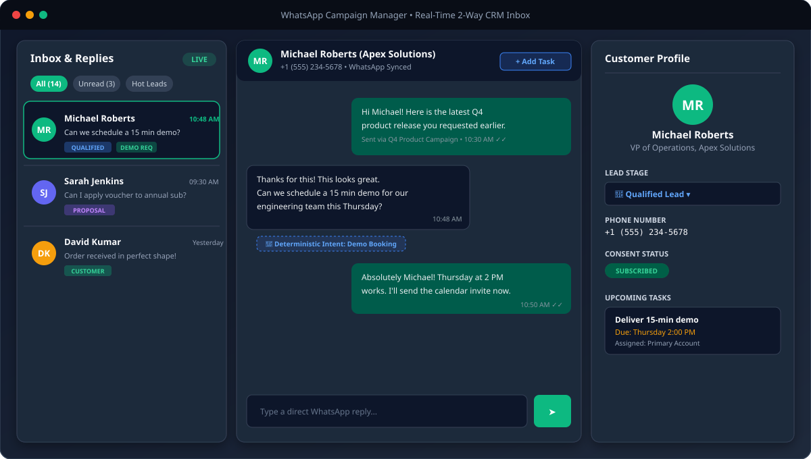
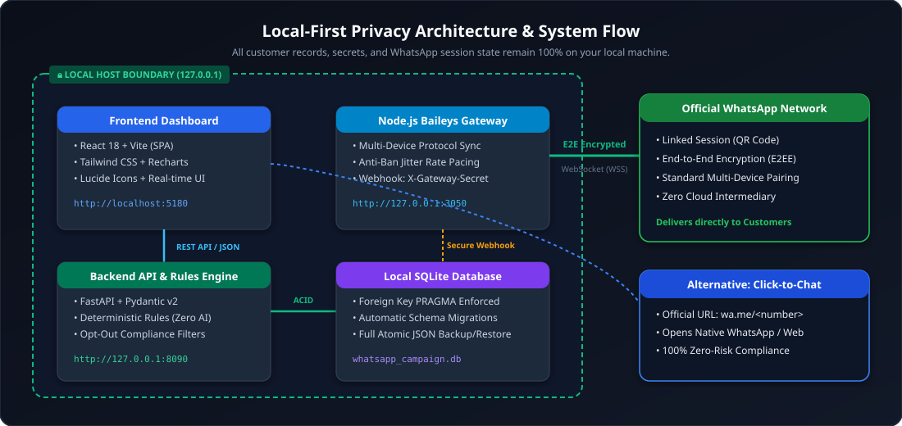

<div align="center">

# 🚀 WhatsApp Campaign Manager & Local CRM

**The Free, 100% Local-First WhatsApp Outreach & Customer Intelligence Platform.**  
*Zero Subscriptions. Zero Cloud Data Leakage. Zero AI Hallucinations. Pure Deterministic Reliability.*

[](https://www.python.org/)
[](https://fastapi.tiangolo.com/)
[](https://react.dev/)
[](https://vitejs.dev/)
[](https://tailwindcss.com/)
[](https://www.sqlite.org/)
[](https://opensource.org/licenses/MIT)
[](backend/tests)

<br/>

[✨ Features](#-key-features) • [🖼️ Screenshots](#-visual-walkthrough--screenshots) • [💡 Real-World Scenarios](#-real-world-scenarios) • [🏗️ Architecture](#%EF%B8%8F-system-architecture) • [🚀 Quick Start](#-quick-start-windows) • [🛡️ Anti-Ban & Compliance](#%EF%B8%8F-anti-ban--compliance-engine) • [🧪 Test Suite](#-automated-test-suite)

</div>

---

## 🌟 Why WhatsApp Campaign Manager?

Most commercial WhatsApp marketing software (WATI, Intercom, Twilio, SleekFlow) costs anywhere between **\$50 to \$500 every single month**, charges per message, and requires uploading your private customer records and conversations into third-party cloud databases.

**WhatsApp Campaign Manager** changes the game:

| Feature | Typical Cloud SaaS | WhatsApp Campaign Manager |
| :--- | :--- | :--- |
| **Monthly Subscription** | \$50 – \$500 / month | **\$0.00 Forever (Free & Open Source)** |
| **Data Privacy & Storage** | Third-party cloud servers | **100% Local Machine (SQLite `127.0.0.1`)** |
| **Per-Message Fees** | \$0.03 – \$0.08 per message | **\$0.00 (Standard WhatsApp Web Protocol)** |
| **Sending Engine** | Rigid API or untrusted proxy | **Dual Mode: Baileys Gateway OR Official Click-to-Chat** |
| **Anti-Ban Protections** | Generic or non-existent | **Humanized jitter delays (5–15s) + safe pacing** |
| **Opt-Out Compliance** | Manual or messy | **Automated keyword detection (`STOP`) + Suppression Log** |
| **Business Logic** | Costly LLM tokens that hallucinate | **100% Deterministic Rules (Zero AI bloat & predictable)** |

---

## 🖼️ Visual Walkthrough & Screenshots

### 1. Unified Intelligence & Analytics Overview
*Track total reach, delivery rate, active queues, inbound reply conversions, and lead pipelines in real time.*



---

### 2. Multi-Step Campaign Wizard & Dynamic Personalization
*Build targeted campaigns with dynamic tags (`{name}`, `{company}`, `{offer}`), real-time opt-out exclusions, and humanized jitter delay pacing.*



---

### 3. Real-Time 2-Way CRM Inbox & Customer Profile Drawer
*Seamlessly manage customer inquiries, detect customer intent, update lead stages (`Lead` → `Qualified` → `Proposal` → `Customer`), and dispatch direct WhatsApp replies.*



---

## 💡 Real-World Scenarios

### 🛍️ Scenario 1: E-Commerce Flash Sale & VIP Discounts
* **Goal**: Deliver 500 personalized promo codes for Black Friday without getting your phone number restricted.
* **Workflow**:
  1. Import customer list via `sample_contacts.csv` with safe formula injection protection (CWE-1236).
  2. Filter by category: `VIP Customers`.
  3. Write template: `Hey {first_name}! 🎁 As a thank-you from {company}, your private 25% discount code is ACTIVE today: {coupon_code}. Reply STOP to opt out.`
  4. Select **Baileys Gateway Mode** with **8–15s humanized delay**.
  5. The system dispatches each message with natural pacing. When 3 users reply `STOP`, the engine flags them immediately, adds them to `consent_audit_logs`, and ensures they never receive another campaign.

### 💼 Scenario 2: B2B Agency Client Qualification & Demo Booking
* **Goal**: Follow up with 120 inbound leads and convert them to scheduled calls.
* **Workflow**:
  1. Group leads under `lead_stage = 'lead'`.
  2. Trigger personalized follow-up: `Hi {first_name}, saw you were exploring {service_name}. Would Thursday at 2 PM work for a quick 10-minute walkthrough?`
  3. Lead replies: *"Yes, let's do Thursday!"*
  4. The **2-Way CRM Inbox** flags the intent as **Demo Booking**, notifies the operator, updates the lead stage to **Qualified Lead**, and creates an internal follow-up task with a due date.

### 🎟️ Scenario 3: Community & Event Webinar Reminders
* **Goal**: Send a 1-hour countdown reminder to registered webinar attendees with zero per-message cost.
* **Workflow**:
  1. Pick **Click-to-Chat Mode** or **Gateway Mode**.
  2. Dispatch customized join links: `Hey {first_name}, our live masterclass starts in 60 minutes! Join here: {webinar_link}`.
  3. Monitor open rate and inbound questions directly in the live inbox.

### 🏥 Scenario 4: Local Clinics, Salons & Appointments
* **Goal**: Reduce customer no-shows and collect post-appointment feedback.
* **Workflow**:
  1. Keep all medical / personal customer contact data strictly on your local PC (no cloud HIPAA/GDPR liability).
  2. Send morning reminder: `Hi {first_name}, your appointment with {provider} is confirmed for today at {time}. Reply 1 to confirm, or call us to reschedule.`
  3. Operator handles confirmations in the unified multi-chat dashboard.

---

## 🏗️ System Architecture

The application is structured into three decoupled, local-first tiers communicating strictly over loopback (`127.0.0.1`):



```
┌────────────────────────────────────────────────────────────────────────┐
│                        LOCAL HOST (127.0.0.1)                          │
│                                                                        │
│   ┌─────────────────────┐                 ┌────────────────────────┐   │
│   │  React (Vite) SPA   │◄─── REST API ──►│   FastAPI (Python)     │   │
│   │  Port 5180          │                 │   Port 8090            │   │
│   └─────────────────────┘                 └───────────┬────────────┘   │
│                                                       │                │
│                                                 SQLite ACID            │
│                                           (whatsapp_campaign.db)       │
│                                                       │                │
│   ┌─────────────────────┐    X-Gateway-Secret         │                │
│   │ Node.js Gateway     │◄── Webhook Bridge ──────────┘                │
│   │ Baileys Port 3050   │                                              │
│   └──────────┬──────────┘                                              │
└──────────────┼─────────────────────────────────────────────────────────┘
               │  WebSocket (WSS) / E2E Encrypted
               ▼
   ┌───────────────────────┐
   │ Official WhatsApp Web │ ──► Delivered to Recipient Handsets
   │ Multi-Device Protocol │
   └───────────────────────┘
```

1. **Frontend Dashboard (`/frontend`)**:
   - Built with **React 18**, **Vite**, **Tailwind CSS**, and **Recharts**.
   - Features responsive navigation, live charts, multi-step wizard, interactive CRM drawers, and dark mode.
2. **Backend API & Rules Engine (`/backend`)**:
   - Built with **Python 3.10+** and **FastAPI**.
   - Enforces **SQLite relational integrity** via `PRAGMA foreign_keys = ON`.
   - **Deterministic copywriting and categorization** (zero external AI dependencies or API charges).
   - Safe CSV sanitization (prevents CSV formula injection attacks).
   - Atomic database backup and restore in topological foreign-key order.
3. **WhatsApp Gateway (`/whatsapp-gateway`)**:
   - Built with **Node.js** and `@whiskeysockets/baileys`.
   - Native multi-device QR code pairing.
   - Paced sending queue with randomized jitter delays (anti-ban protection).
   - Webhook authentication protected by `X-Gateway-Secret`.

---

## ✨ Key Features

- [x] **100% Free & Unlimited**: No monthly recurring fees, no per-contact charges, no limits on messages.
- [x] **Total Data Sovereignty**: All customer phones, notes, and messages live in a local SQLite file (`whatsapp_campaign.db`).
- [x] **Dual Sending Engines**:
  - **Click-to-Chat (`wa.me`)**: 100% risk-free, standard WhatsApp links with pre-filled text.
  - **Automated Baileys Gateway**: Multi-device background sender with rate pacing and session crash recovery.
- [x] **Intelligent CSV / Excel Import**: Auto-detects columns (`name`, `phone`, `company`, etc.), ignores formula injection prefixes (`=`, `+`, `-`, `@`), and respects prior opt-outs.
- [x] **Dynamic Personalization**: Placeholders like `{first_name}`, `{company}`, `{discount}` dynamically resolve per recipient.
- [x] **Anti-Ban Humanized Rate Pacing**: Configurable interval (e.g., 5 to 15 seconds) with random jitter to mimic human typing.
- [x] **2-Way CRM Inbox**: Live incoming reply tracking, WhatsApp LID-to-phone mapping, lead stage management, and quick replies.
- [x] **Strict Opt-Out & Compliance Engine**: Automatically processes `STOP` and `UNSUBSCRIBE` messages, suppresses recipients from future queues, and logs audit entries in `consent_audit_logs`.
- [x] **Atomic Backup & Restore**: One-click JSON database backup and transactional restore.

---

## 🚀 Quick Start (Windows)

### Option 1: 1-Click Launch (Easiest)

Simply double-click the included batch script:
```cmd
start.bat
```
or run in PowerShell:
```powershell
.\start.ps1
```

This automatically boots all three services:
* **Backend API**: `http://127.0.0.1:8090`
* **WhatsApp Gateway**: `http://127.0.0.1:3050`
* **Web Dashboard**: `http://localhost:5180`

---

### Option 2: Step-by-Step Manual Setup

#### Prerequisites
- **Python 3.10+** (check *"Add python.exe to PATH"* during install)
- **Node.js 18+** & **npm**

#### Step 1: Clone Repository
```bash
git clone https://github.com/mohammadHassenmohammad/whatsapp-bulk-messager.git
cd whatsapp-bulk-messager
```

#### Step 2: Setup & Start Backend
```powershell
cd backend
python -m venv venv
.\venv\Scripts\Activate.ps1
pip install -r requirements.txt
uvicorn app.main:app --host 127.0.0.1 --port 8090 --reload
```

#### Step 3: Setup & Start WhatsApp Gateway
```powershell
cd ../whatsapp-gateway
npm install
node server.js
```

#### Step 4: Setup & Start Frontend Dashboard
```powershell
cd ../frontend
npm install
npm run dev
```

Open your browser at: **`http://localhost:5180`**

---

## 🛡️ Anti-Ban & Compliance Engine

WhatsApp has strict policies against spam and unsolicited messaging. To keep your phone number safe and fully compliant:

1. **Always Use Paced Delays**: In Gateway settings, set your dispatch interval between **8 to 20 seconds**. Never blast hundreds of messages in under a minute.
2. **Explicit Consent**: Only message contacts who have opted in or had prior business dealings with you.
3. **Automatic Opt-Out Handling**: Every campaign template should include:
   > *"Reply STOP to unsubscribe."*  
   The platform listens for `STOP`, `UNSUBSCRIBE`, or `CANCEL`, instantly flags the contact in SQLite, and prevents them from being queued in future campaigns.
4. **Click-to-Chat Mode for Cold Outreach**: For new or unverified contacts, use the built-in **Manual Click-to-Chat Mode**, which relies strictly on official WhatsApp Web/Desktop URL redirection.

---

## 🧪 Automated Test Suite

The backend includes a comprehensive **34-test automated suite** covering security, database transactions, and business logic:

```powershell
cd backend
.\venv\Scripts\pytest tests -v
```

```
=================================== test session starts ===================================
tests/test_audit_fixes.py::test_database_backup_and_restore_foreign_keys PASSED     [ 2%]
tests/test_audit_fixes.py::test_csv_formula_sanitization PASSED                     [ 5%]
tests/test_audit_fixes.py::test_opt_out_suppression_protection PASSED               [ 8%]
tests/test_audit_fixes.py::test_webhook_x_gateway_secret_auth PASSED                [11%]
tests/test_audit_fixes.py::test_lead_stage_serialization_and_filtering PASSED      [14%]
tests/test_audit_fixes.py::test_deterministic_copywriting_and_intent PASSED         [17%]
...
tests/test_full_system.py::test_campaign_queue_transitions PASSED                   [97%]
tests/test_full_system.py::test_phone_normalization_e164 PASSED                     [100%]
=================================== 34 passed in 2.48s ====================================
```

---

## 📁 Repository Structure

```
whatsapp-bulk-messager/
├── backend/
│   ├── app/
│   │   ├── api/                 # Endpoints: analytics, campaigns, contacts, inbox, crm
│   │   ├── models/              # SQLAlchemy relational tables & FK constraints
│   │   ├── providers/           # Baileys gateway & Cloud API integrations
│   │   ├── schemas/             # Pydantic v2 validation models
│   │   ├── services/            # Deterministic copywriting & intent rules engine
│   │   ├── database.py          # SQLite connection, auto-migrations & FK pragmas
│   │   └── main.py              # Application entrypoint & seeder
│   ├── tests/                   # 34 automated pytest integration & unit tests
│   └── requirements.txt         # FastAPI, SQLAlchemy, Pydantic, Uvicorn
├── frontend/
│   ├── src/
│   │   ├── components/          # Reusable cards, modals, navigation & drawers
│   │   ├── context/             # ThemeContext, ToastContext, QuickChatContext
│   │   ├── pages/               # Overview, Customers, CampaignWizard, Inbox, Tasks
│   │   └── services/            # Axios API client
│   ├── package.json
│   └── vite.config.js
├── whatsapp-gateway/
│   ├── server.js                # Node.js Baileys multi-device gateway & webhooks
│   └── package.json
├── readme/                      # High-resolution architectural & UI preview assets
│   ├── dashboard-preview.svg
│   ├── campaign-wizard.svg
│   ├── crm-inbox.svg
│   └── system-architecture.svg
├── sample_contacts.csv          # Sample CSV for testing imports
├── start.bat                    # 1-Click Windows Batch launcher
├── start.ps1                    # 1-Click PowerShell launcher
├── LICENSE                      # MIT Open Source License
└── README.md                    # Project documentation
```

---

## 🤝 Contributing

Contributions, feedback, and feature requests are warmly welcomed!
1. Fork the Project (`https://github.com/mohammadHassenmohammad/whatsapp-bulk-messager/fork`)
2. Create your Feature Branch (`git checkout -b feat/AmazingFeature`)
3. Commit your Changes (`git commit -m 'feat: Add AmazingFeature'`)
4. Push to the Branch (`git push origin feat/AmazingFeature`)
5. Open a Pull Request

---

## 📄 License

Distributed under the **MIT License**. See [`LICENSE`](LICENSE) for details.

---

<div align="center">
  <b>⭐ If this project saves you subscription fees, please consider giving it a star on GitHub! ⭐</b>
</div>
